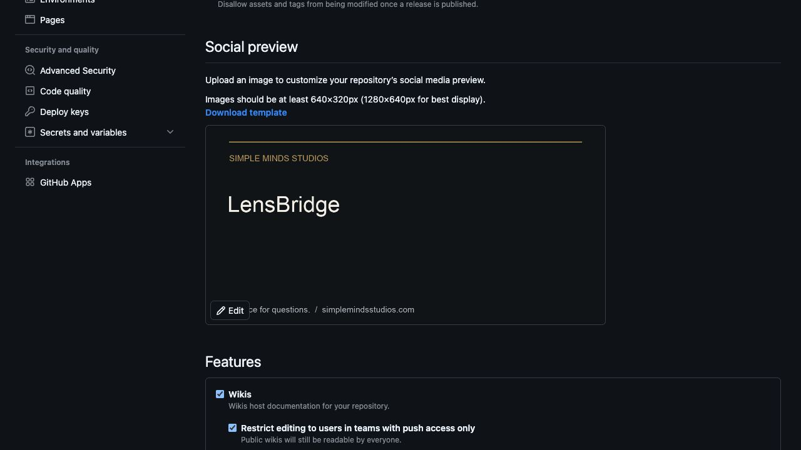

# SMS repository completeness audit — November 20, 2026

The organization contains **23 repositories: 22 public and one private**. Each was inventoried individually and compared with its personal-account counterpart when one exists. **21 public websites** were checked over HTTPS, including their favicon and social-share image URLs. The organization profile repository is support infrastructure, not a separate website.

## What changed

- Completed descriptions and canonical website addresses; added missing README material, `.gitignore` rules and private security-reporting guidance.
- Merged missing personal default-branch work into the studio website, SpineFlow and Linc(d), retaining the original source commits. Divergent histories remain identifiable through main ancestry, archive branches and `.github/migration/personal-source.json` records.
- Preserved existing licenses, earlier grants, third-party notices and collaborator credits. This audit did not relicense the projects.
- Enabled secret scanning, push protection and private vulnerability reporting on all **22 public repositories**. Dependabot alerts are enabled for **all 23 repositories**.
- Added default-branch rules blocking force pushes and branch deletion on **22 public repositories**. Ordinary forward commits remain possible. GitHub’s current plan rejected that rule for the private repository; it remains private.
- Set default Actions tokens to read-only and disabled workflow approval of pull requests on **all 23 repositories**. Existing workflows retain their explicitly declared deployment permissions.

## Repository-by-repository results

Descriptions, ignore rules, security guidance and available protections were completed for every row below. Private research details are recorded only in the private repository.

| Public repository | Source continuity | Published presentation | Individual result |
| --- | --- | --- | --- |
| [simplemindsstudios.github.io](https://github.com/Simple-Minds-Studios/simplemindsstudios.github.io) | Personal history retained in main/archive | [Live](https://simplemindsstudios.com/) · HTTPS · image/icon verified | Canonical studio domain retained; personal history merged; stale legacy CNAME removed from active source. |
| [RomanMAST](https://github.com/Simple-Minds-Studios/RomanMAST) | Personal history retained in main/archive | [Live](https://simple-minds-studios.github.io/RomanMAST/) · HTTPS · image/icon verified | Personal commits already retained; source release/tag recorded. Flint review applied: separate events, plain-language provenance, corrected counts and mobile viewer. |
| [thinking-clearer](https://github.com/Simple-Minds-Studios/thinking-clearer) | Organization-only source | [Live](https://simple-minds-studios.github.io/thinking-clearer/) · HTTPS · image/icon verified | Description, public contact route, favicon and page share image completed. |
| [spineflow-tiny-showcase](https://github.com/Simple-Minds-Studios/spineflow-tiny-showcase) | Personal history retained in main/archive | [Live](https://simple-minds-studios.github.io/spineflow-tiny-showcase/) · HTTPS · image/icon verified | Merged newer static gallery, retained original exhibit; removed unused third-party dependency declarations and legacy lockfile from active build. |
| [.github](https://github.com/Simple-Minds-Studios/.github) | Organization-only source | Organization support · no Pages | Organization profile/support repository; no separate Pages site intended. |
| [witness-multiple](https://github.com/Simple-Minds-Studios/witness-multiple) | Personal history retained in main/archive | [Live](https://simple-minds-studios.github.io/witness-multiple/) · HTTPS · image/icon verified | Historical source branches retained; organization links and existing project share artwork repaired. |
| [sms-standards](https://github.com/Simple-Minds-Studios/sms-standards) | Organization-only source | [Live](https://simple-minds-studios.github.io/sms-standards/) · HTTPS · image/icon verified | Restored intended manual website; missing chapter links are labeled planned rather than presented as existing files. |
| [project-voyager-iii](https://github.com/Simple-Minds-Studios/project-voyager-iii) | Personal history retained in main/archive | [Live](https://simple-minds-studios.github.io/project-voyager-iii/) · HTTPS · image/icon verified | Retained research concept; completed title, README, image, favicon and provenance. |
| [project-wayfinder](https://github.com/Simple-Minds-Studios/project-wayfinder) | Personal history retained in main/archive | [Live](https://simple-minds-studios.github.io/project-wayfinder/) · HTTPS · image/icon verified | Retained research concept; completed description, README, image, favicon and provenance. |
| [project-aurelia](https://github.com/Simple-Minds-Studios/project-aurelia) | Personal history retained in main/archive | [Live](https://simple-minds-studios.github.io/project-aurelia/) · HTTPS · image/icon verified | Retained research concept; completed description, README, image, favicon and provenance. |
| [best-human-moment](https://github.com/Simple-Minds-Studios/best-human-moment) | Personal history retained in main/archive | [Live](https://simple-minds-studios.github.io/best-human-moment/) · HTTPS · image/icon verified | Preserved Human Room presentation and original artwork; repaired canonical metadata. |
| [glam-confession](https://github.com/Simple-Minds-Studios/glam-confession) | Personal history retained in main/archive | [Live](https://simple-minds-studios.github.io/glam-confession/) · HTTPS · image/icon verified | Preserved editorial portfolio; added page preview metadata and favicon. |
| [low-visibility-brand-bible](https://github.com/Simple-Minds-Studios/low-visibility-brand-bible) | Personal history retained in main/archive | [Live](https://simple-minds-studios.github.io/low-visibility-brand-bible/) · HTTPS · image/icon verified | Preserved brand archive; repaired organization links and preview assets. |
| [Low-Visibility-Lookbooks](https://github.com/Simple-Minds-Studios/Low-Visibility-Lookbooks) | Personal history retained in main/archive | [Live](https://simple-minds-studios.github.io/Low-Visibility-Lookbooks/) · HTTPS · image/icon verified | Preserved lookbooks; corrected case-sensitive social-preview.PNG address. |
| [public-website.github.io](https://github.com/Simple-Minds-Studios/public-website.github.io) | Separate website trajectories retained | [Live](https://simple-minds-studios.github.io/public-website.github.io/) · HTTPS · image/icon verified | Preserved independent Atlas Museum trajectory; removed stale studio-domain CNAME. |
| [still-here](https://github.com/Simple-Minds-Studios/still-here) | Organization-only source | [Live](https://simple-minds-studios.github.io/still-here/) · HTTPS · image/icon verified | Preserved Bart Salazar stewardship, evidence labels and privacy boundaries; completed preview assets. |
| [the-anonymous-family](https://github.com/Simple-Minds-Studios/the-anonymous-family) | Organization-only source | [Live](https://simple-minds-studios.github.io/the-anonymous-family/) · HTTPS · image/icon verified | Preserved Brad Devowe stewardship, privacy rules and project-specific artwork. |
| [mi-tech-bros](https://github.com/Simple-Minds-Studios/mi-tech-bros) | Organization-only source | [Live](https://simple-minds-studios.github.io/mi-tech-bros/) · HTTPS · image/icon verified | Completed concise description, website metadata, favicon and share image. |
| [the-moving-frame](https://github.com/Simple-Minds-Studios/the-moving-frame) | Personal counterpart is empty | [Live](https://simple-minds-studios.github.io/the-moving-frame/) · HTTPS · image/icon verified | Preserved archive-in-preparation status; completed presentation metadata and assets. |
| [the-hart-protocol](https://github.com/Simple-Minds-Studios/the-hart-protocol) | Personal history retained in main/archive | [Live](https://simple-minds-studios.github.io/the-hart-protocol/) · HTTPS · image/icon verified | Preserved civic editorial and source history; repaired organization links and metadata. |
| [agent-skills](https://github.com/Simple-Minds-Studios/agent-skills) | Organization-only source | [Live](https://simple-minds-studios.github.io/agent-skills/) · HTTPS · image/icon verified | Preserved separate Linc(d) prototype; build and published assets verified. |
| [lincd-public](https://github.com/Simple-Minds-Studios/lincd-public) | Personal history retained in main/archive | [Live](https://simple-minds-studios.github.io/lincd-public/) · HTTPS · image/icon verified | Merged six newer personal handoff commits, including cross-model review corrections; Vite deployment passed. |

## Source records and GitHub-specific limits

Personal repositories remain intact. Source branch names, commit identities, tags, issue/pull-request records and release metadata are retained in migration records where counterparts exist. GitHub issue numbers, original review threads, check-run IDs, release timestamps, credentials and repository permissions are not Git objects; original platform records remain at their source URLs. No secret values were copied.

The old LensBridge source release/tag points to a commit already retained in organization ancestry. GitHub email-privacy protection declined a duplicate tag reference; the original release metadata and source reference were recorded rather than disabling that protection or changing historical author identities.

Private research source history and original rights files were preserved in a private archive branch. Personal research entries, PDFs and separate research histories were not bulk-imported. Any future public edition still requires its separate privacy review.

## Images and publication

All 21 Pages sites have functioning page-level social-preview images and favicons. Existing project artwork was retained when valid; missing previews received an exact-text studio card. These cards are presentation assets, not scientific observations.

Page-share metadata and GitHub’s separate repository-card upload are different settings. LensBridge’s custom GitHub repository preview was uploaded and confirmed. Other repository cards remain GitHub-generated; their repository descriptions have been corrected.

## Validation and meaningful findings

- Inspected **1,079 unique text/code blobs** across fetched histories for credential patterns. Two token-shaped substrings were embedded media, not standalone credentials. This bounded check is not a complete personal-information or penetration-test audit.
- LensBridge: **27 Python tests**, viewer parsing/loading checks, phone-width bounds, full-range endpoint preservation and readable point values passed. Both events are explicitly separated. Event 1093 contains 1,368 OGLE, 1,500 KMTNet, 36 Spitzer and 7,824 MOA measurements: **10,728 total**. Event 1190 contains **10,560 reproduced normalized rows**.
- SpineFlow: **seven tests** and the static build passed; the original experimental exhibit is retained at `legacy/spineflow-v5.6.html` in its deployment.
- SpineFlow’s obsolete `pnpm-lock.yaml` triggered **111 dependency alerts** (3 critical, 53 high, 39 medium and 16 low). The active gallery uses no third-party packages. The unused root dependency declarations and lockfile were removed from the active branch; their original bytes remain in history. No alerts were manually dismissed to conceal findings. GitHub subsequently refreshed its dependency analysis and automatically marked **all 111 alerts fixed**, with **zero open alerts**, 111 fixed timestamps and no dismissal actors. A proposed bulk dismissal had been blocked by automatic approval review; no manual dismissal was performed or needed. The underlying unused dependency tree was removed, the original files remain in history, and the corrective deployment passed.
- Current Pages deployments for the studio, manual, SpineFlow, Agent Skills and Linc(d) succeeded. SpineFlow’s first post-cleanup deployment encountered a transient artifact-listing error; the retry succeeded at [run 44862684304](https://github.com/Simple-Minds-Studios/spineflow-tiny-showcase/actions/runs/44862684304). Earlier failed runs remain as historical records.
- The Lookbooks `.PNG`/`.png` mismatch was fixed and the corrected image returned HTTP 200.
- The canonical studio domain remains assigned to `Simple-Minds-Studios/simplemindsstudios.github.io`; Atlas Museum retains its independent project address.

The private repository has no Pages deployment. Its publication boundary and plan-dependent history-rule limitation remain documented privately.
